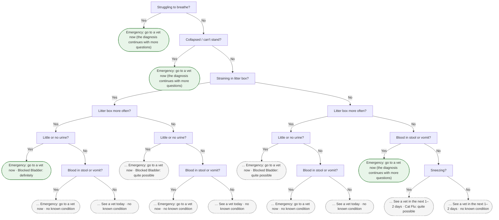

# CatCare decision tree

Generated by `python tools/draw_tree.py` from the rules in `kb/` (do not edit by hand).
Each tree shows up to 6 questions; a rounded box is a result. Boxes starting
with … are cut at the depth limit and show the result if every later answer is "not sure".

## 1. Triage: danger signs first

27 nodes.



## 2. Diagnosis: after triage finds no danger sign

105 nodes.

```mermaid
flowchart TD
    classDef result fill:#e8f5e9,stroke:#2e7d32
    classDef cut fill:#f5f5f5,stroke:#9e9e9e,stroke-dasharray: 4 3
    d1["Sneezing?"]
    d2["Eye discharge?"]
    d3["Nose discharge?"]
    d4["Red or swollen eyes?"]
    d5["Eating?"]
    d6["Tired, weak or hiding?"]
    d7(["… See a vet in the next 1–2 days · Cat Flu: definitely"])
    class d7 cut
    d6 -->|Yes| d7
    d8(["… Care at home and watch closely · Cat Flu: definitely"])
    class d8 cut
    d6 -->|No| d8
    d5 -->|Eating normally| d6
    d9(["… See a vet in the next 1–2 days · Cat Flu: definitely"])
    class d9 cut
    d5 -->|Eating less| d9
    d10(["See a vet today · Cat Flu: definitely"])
    class d10 result
    d5 -->|Not eating at all| d10
    d4 -->|Yes| d5
    d11["Mouth sores / drooling?"]
    d12["Eating?"]
    d13(["… Care at home and watch closely · Cat Flu: definitely"])
    class d13 cut
    d12 -->|Eating normally| d13
    d14(["… See a vet in the next 1–2 days · Cat Flu: definitely"])
    class d14 cut
    d12 -->|Eating less| d14
    d15(["… See a vet today · Cat Flu: definitely"])
    class d15 cut
    d12 -->|Not eating at all| d15
    d11 -->|Yes| d12
    d16["Near other cats?"]
    d17(["… See a vet in the next 1–2 days · Cat Flu: definitely"])
    class d17 cut
    d16 -->|Yes| d17
    d18(["… See a vet in the next 1–2 days · Cat Flu: quite possible"])
    class d18 cut
    d16 -->|No| d18
    d11 -->|No| d16
    d4 -->|No| d11
    d3 -->|Yes| d4
    d19["Red or swollen eyes?"]
    d20["Eating?"]
    d21["Tired, weak or hiding?"]
    d22(["… See a vet in the next 1–2 days · Cat Flu: definitely"])
    class d22 cut
    d21 -->|Yes| d22
    d23(["… Care at home and watch closely · Cat Flu: definitely"])
    class d23 cut
    d21 -->|No| d23
    d20 -->|Eating normally| d21
    d24(["… See a vet in the next 1–2 days · Cat Flu: definitely"])
    class d24 cut
    d20 -->|Eating less| d24
    d25(["See a vet today · Cat Flu: definitely"])
    class d25 result
    d20 -->|Not eating at all| d25
    d19 -->|Yes| d20
    d26["Mouth sores / drooling?"]
    d27["Eating?"]
    d28(["… Care at home and watch closely · Cat Flu: definitely"])
    class d28 cut
    d27 -->|Eating normally| d28
    d29(["… See a vet in the next 1–2 days · Cat Flu: definitely"])
    class d29 cut
    d27 -->|Eating less| d29
    d30(["… See a vet today · Cat Flu: definitely"])
    class d30 cut
    d27 -->|Not eating at all| d30
    d26 -->|Yes| d27
    d31["Near other cats?"]
    d32(["… See a vet in the next 1–2 days · Cat Flu: definitely"])
    class d32 cut
    d31 -->|Yes| d32
    d33(["… See a vet in the next 1–2 days · Cat Flu: quite possible"])
    class d33 cut
    d31 -->|No| d33
    d26 -->|No| d31
    d19 -->|No| d26
    d3 -->|No| d19
    d2 -->|Yes| d3
    d34["Nose discharge?"]
    d35["Mouth sores / drooling?"]
    d36["Eating?"]
    d37["Tired, weak or hiding?"]
    d38(["… See a vet in the next 1–2 days · Cat Flu: definitely"])
    class d38 cut
    d37 -->|Yes| d38
    d39(["… Care at home and watch closely · Cat Flu: definitely"])
    class d39 cut
    d37 -->|No| d39
    d36 -->|Eating normally| d37
    d40(["… See a vet in the next 1–2 days · Cat Flu: definitely"])
    class d40 cut
    d36 -->|Eating less| d40
    d41(["See a vet today · Cat Flu: definitely"])
    class d41 result
    d36 -->|Not eating at all| d41
    d35 -->|Yes| d36
    d42["Near other cats?"]
    d43["Eating?"]
    d44(["… Care at home and watch closely · Cat Flu: definitely"])
    class d44 cut
    d43 -->|Eating normally| d44
    d45(["… See a vet in the next 1–2 days · Cat Flu: definitely"])
    class d45 cut
    d43 -->|Eating less| d45
    d46(["… See a vet today · Cat Flu: definitely"])
    class d46 cut
    d43 -->|Not eating at all| d46
    d42 -->|Yes| d43
    d47(["… See a vet in the next 1–2 days · Cat Flu: quite possible"])
    class d47 cut
    d42 -->|No| d47
    d35 -->|No| d42
    d34 -->|Yes| d35
    d48["Mouth sores / drooling?"]
    d49["Near other cats?"]
    d50["Temperature?"]
    d51(["… See a vet in the next 1–2 days · Cat Flu: quite possible"])
    class d51 cut
    d50 -->|Normal (up to 102.5 °F / 39.2 °C)| d51
    d52(["… See a vet in the next 1–2 days · Cat Flu: definitely"])
    class d52 cut
    d50 -->|High (above 102.5 °F / 39.2 °C)| d52
    d49 -->|Yes| d50
    d53(["… See a vet in the next 1–2 days · Cat Flu: quite possible"])
    class d53 cut
    d49 -->|No| d53
    d48 -->|Yes| d49
    d54(["… See a vet in the next 1–2 days · Cat Flu: quite possible"])
    class d54 cut
    d48 -->|No| d54
    d34 -->|No| d48
    d2 -->|No| d34
    d1 -->|Yes| d2
    d55["Eye discharge?"]
    d56["Nose discharge?"]
    d57["Red or swollen eyes?"]
    d58["Eating?"]
    d59["Tired, weak or hiding?"]
    d60(["… See a vet in the next 1–2 days · Cat Flu: definitely"])
    class d60 cut
    d59 -->|Yes| d60
    d61(["… Care at home and watch closely · Cat Flu: definitely"])
    class d61 cut
    d59 -->|No| d61
    d58 -->|Eating normally| d59
    d62(["… See a vet in the next 1–2 days · Cat Flu: definitely"])
    class d62 cut
    d58 -->|Eating less| d62
    d63(["See a vet today · Cat Flu: definitely"])
    class d63 result
    d58 -->|Not eating at all| d63
    d57 -->|Yes| d58
    d64["Mouth sores / drooling?"]
    d65["Eating?"]
    d66(["… Care at home and watch closely · Cat Flu: definitely"])
    class d66 cut
    d65 -->|Eating normally| d66
    d67(["… See a vet in the next 1–2 days · Cat Flu: definitely"])
    class d67 cut
    d65 -->|Eating less| d67
    d68(["… See a vet today · Cat Flu: definitely"])
    class d68 cut
    d65 -->|Not eating at all| d68
    d64 -->|Yes| d65
    d69["Near other cats?"]
    d70(["… See a vet in the next 1–2 days · Cat Flu: definitely"])
    class d70 cut
    d69 -->|Yes| d70
    d71(["… See a vet in the next 1–2 days · Cat Flu: quite possible"])
    class d71 cut
    d69 -->|No| d71
    d64 -->|No| d69
    d57 -->|No| d64
    d56 -->|Yes| d57
    d72["Red or swollen eyes?"]
    d73["Mouth sores / drooling?"]
    d74["Eating?"]
    d75(["… Care at home and watch closely · Cat Flu: definitely"])
    class d75 cut
    d74 -->|Eating normally| d75
    d76(["… See a vet in the next 1–2 days · Cat Flu: definitely"])
    class d76 cut
    d74 -->|Eating less| d76
    d77(["… See a vet today · Cat Flu: definitely"])
    class d77 cut
    d74 -->|Not eating at all| d77
    d73 -->|Yes| d74
    d78["Near other cats?"]
    d79(["… See a vet in the next 1–2 days · Cat Flu: definitely"])
    class d79 cut
    d78 -->|Yes| d79
    d80(["… See a vet in the next 1–2 days · Cat Flu: quite possible"])
    class d80 cut
    d78 -->|No| d80
    d73 -->|No| d78
    d72 -->|Yes| d73
    d81(["… See a vet in the next 1–2 days · Cat Flu: quite possible"])
    class d81 cut
    d72 -->|No| d81
    d56 -->|No| d72
    d55 -->|Yes| d56
    d82["Nose discharge?"]
    d83["Mouth sores / drooling?"]
    d84["Near other cats?"]
    d85["Temperature?"]
    d86(["… See a vet in the next 1–2 days · Cat Flu: quite possible"])
    class d86 cut
    d85 -->|Normal (up to 102.5 °F / 39.2 °C)| d86
    d87(["… See a vet in the next 1–2 days · Cat Flu: definitely"])
    class d87 cut
    d85 -->|High (above 102.5 °F / 39.2 °C)| d87
    d84 -->|Yes| d85
    d88(["… See a vet in the next 1–2 days · Cat Flu: quite possible"])
    class d88 cut
    d84 -->|No| d88
    d83 -->|Yes| d84
    d89(["… See a vet in the next 1–2 days · Cat Flu: quite possible"])
    class d89 cut
    d83 -->|No| d89
    d82 -->|Yes| d83
    d90["Vomiting?"]
    d91["Diarrhoea?"]
    d92["Age?"]
    d93(["… Emergency: go to a vet now · Cat Parvo: maybe"])
    class d93 cut
    d92 -->|Kitten (under 1 year)| d93
    d94(["… See a vet in the next 1–2 days · no known condition"])
    class d94 cut
    d92 -->|Adult (1 year or older)| d94
    d91 -->|Yes| d92
    d95["Age?"]
    d96(["… Emergency: go to a vet now · Cat Parvo: maybe"])
    class d96 cut
    d95 -->|Kitten (under 1 year)| d96
    d97(["… See a vet in the next 1–2 days · no known condition"])
    class d97 cut
    d95 -->|Adult (1 year or older)| d97
    d91 -->|No| d95
    d90 -->|Yes| d91
    d98["Diarrhoea?"]
    d99["Age?"]
    d100(["… Emergency: go to a vet now · Cat Parvo: maybe"])
    class d100 cut
    d99 -->|Kitten (under 1 year)| d100
    d101(["… See a vet in the next 1–2 days · no known condition"])
    class d101 cut
    d99 -->|Adult (1 year or older)| d101
    d98 -->|Yes| d99
    d102["Eating?"]
    d103(["See a vet in the next 1–2 days · no known condition"])
    class d103 result
    d102 -->|Eating normally| d103
    d104(["See a vet in the next 1–2 days · no known condition"])
    class d104 result
    d102 -->|Eating less| d104
    d105(["… See a vet in the next 1–2 days · no known condition"])
    class d105 cut
    d102 -->|Not eating at all| d105
    d98 -->|No| d102
    d90 -->|No| d98
    d82 -->|No| d90
    d55 -->|No| d82
    d1 -->|No| d55
```
